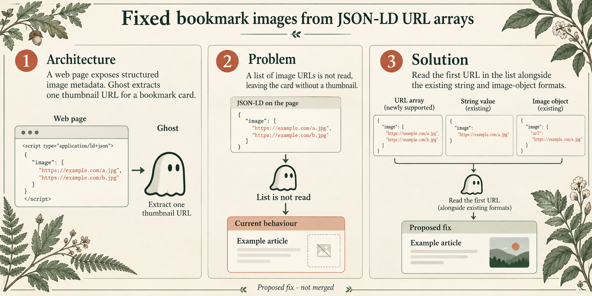

# Fixed bookmark images from JSON-LD URL arrays



## Architecture, problem and solution

Architecture: a web page exposes structured image metadata; Ghost extracts one thumbnail URL for a bookmark card. Problem: a list of image URLs is not read, leaving the card without a thumbnail. Solution: read the first URL in the list alongside the existing string and image-object formats.

## Scope and validation

Regression cases cover URL arrays, string values and image objects. Conceptual illustration of the proposed source fix; no CI or merge claim.

This is a conceptual diagram, not a UI screenshot. The fix is proposed; the image does not claim an upstream merge or passing CI. See the linked PR for test results.

## Generation

Theme: botanical. Generated with the native imagegen tool. The final PNG was visually reviewed.

```text
Use case: infographic-diagram. Asset: a Ghost GitHub pull request illustration. Create a polished wide technical infographic, with large readable English type. Theme: Botanical field guide on ivory paper, forest green, terracotta, fine engraved leaves at margins. Use three numbered conceptual panels: Architecture, Problem, Solution. Show the real flow with clear arrows. Explain simply using only the facts below. Keep decorative motifs at the margins. Distinguish current behavior from the proposed fix. Footer: "Proposed fix - not merged". Do not invent benchmarks, severity, CI results, approval, logos, customer data or watermarks. Minimal words, generous whitespace.
Title: Fixed bookmark images from JSON-LD URL arrays
Facts: Architecture: a web page exposes structured image metadata; Ghost extracts one thumbnail URL for a bookmark card. Problem: a list of image URLs is not read, leaving the card without a thumbnail. Solution: read the first URL in the list alongside the existing string and image-object formats.
Validation/context: Regression cases cover URL arrays, string values and image objects. Conceptual illustration of the proposed source fix; no CI or merge claim.
```
