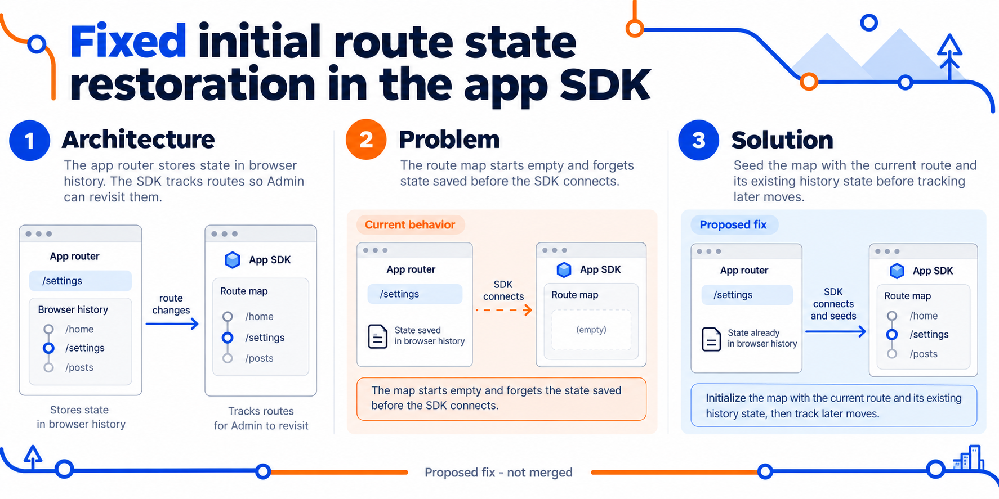

# Fixed initial route state restoration in the app SDK



## Architecture, problem and solution

Architecture: the app router stores state in browser history; the SDK tracks routes so Admin can revisit them. Problem: the route map starts empty and forgets state saved before the SDK connects. Solution: seed the map with the current route and its existing history state before tracking later moves.

## Scope and validation

Private unpublished SDK. Regression test revisits the initial route and checks restored browser state and popstate event. Proposed fix only.

This is a conceptual diagram, not a UI screenshot. The fix is proposed; the image does not claim an upstream merge or passing CI. See the linked PR for test results.

## Generation

Theme: metro. Generated with the native imagegen tool. The final PNG was visually reviewed.

```text
Use case: infographic-diagram. Asset: a Ghost GitHub pull request illustration. Create a polished wide technical infographic, with large readable English type. Theme: Modern metro map, white background, cobalt and orange, clean route lines and station symbols. Use three numbered conceptual panels: Architecture, Problem, Solution. Show the real flow with clear arrows. Explain simply using only the facts below. Keep decorative motifs at the margins. Distinguish current behavior from the proposed fix. Footer: "Proposed fix - not merged". Do not invent benchmarks, severity, CI results, approval, logos, customer data or watermarks. Minimal words, generous whitespace.
Title: Fixed initial route state restoration in the app SDK
Facts: Architecture: the app router stores state in browser history; the SDK tracks routes so Admin can revisit them. Problem: the route map starts empty and forgets state saved before the SDK connects. Solution: seed the map with the current route and its existing history state before tracking later moves.
Validation/context: Private unpublished SDK. Regression test revisits the initial route and checks restored browser state and popstate event. Proposed fix only.
```
