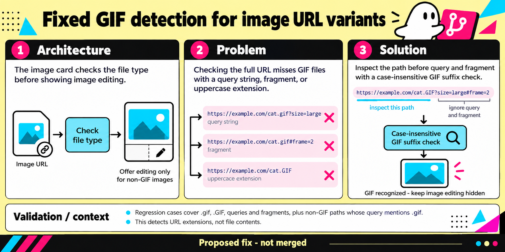

# B3: GIF URL classification

This native imagegen edit is a conceptual diagram, not a UI screenshot. The proposed fix is not merged.

The diagram shows ImageCard checking the URL's file type before deciding whether to show image editing. The bug is that the current case-sensitive suffix check uses the full URL, so query strings, fragments, or uppercase extensions can make a GIF look editable. The proposed fix checks the path suffix without query or fragment text and ignores case. The Solution card now shows the recognized GIF without an editor pencil; the separate Architecture panel still illustrates the editing control for non-GIF images.

The validation strip describes URL-extension cases, not file-byte inspection. The recorded reproduction used a loopback fixture serving identical GIF bytes for the variants.

Theme brief: pop-art, generated with scripts/pr_infographic_prompt.py.

Prompt used for the native imagegen edit:

Use case: infographic-diagram. Asset: Ghost PR infographic. Theme: restrained geometric pop art in pale yellow, black, cyan, and magenta. Retain the wide three-panel Architecture, Problem, Solution layout and existing title, examples, captions, validation strip, and footer. Correct only the Solution panel's bottom card: remove its pencil/edit-control symbol and show an image-only card to communicate that GIF editing stays hidden. Do not remove the Architecture panel's separate pencil icon. Preserve all wording and factual claims. Keep the proposed-fix footer. No new marks, labels, or examples.

Use the image as the edit target. Preserve the rest of the original composition closely.
