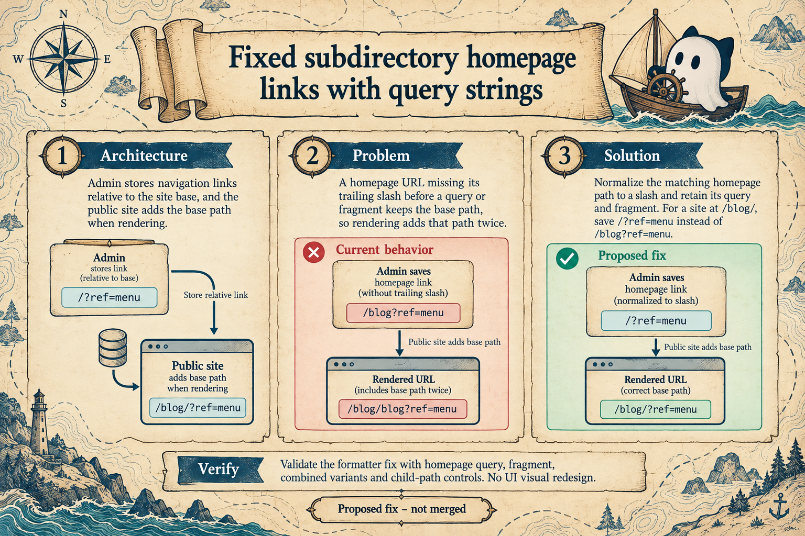

# B4: Subdirectory homepage links with query strings

## Current validation

- Focused homepage URL test: **1 passed** (four URL fixtures). From `apps/admin/`: `pnpm exec vitest run src/settings/utils/format-url.home.test.ts --maxWorkers=1 --no-file-parallelism`.
- PR: [#32137](https://github.com/TryGhost/Ghost/pull/32137).
- Full `pnpm check`: attempted, exited 130 after formatting/Oxlint passed; Nx lint/build tasks failed on this Windows environment. The full test stage was not reached. See the PR and the validation archive for details. Product CI and migration staging review remain unverified.

> **Historical generation record:** The content below records the image-generation context and status at that time. Any test-status statement below is superseded by Current validation above; the generation prompt is preserved unchanged.

**Architecture:** Admin stores navigation links relative to the configured site base. The public site adds that base path when it renders a link.

**Problem:** On a site at `/blog/`, a homepage URL such as `/blog?ref=menu` keeps `/blog` in the saved value. Rendering adds the base path again and produces `/blog/blog?ref=menu`.

**Proposed solution:** Recognize the homepage path without its trailing slash, save it as `/`, and preserve its query string or fragment. The change is proposed and not merged.

**Validation shown:** Query, fragment, combined query-and-fragment, and child-path controls. The infographic describes proposed checks, not a completed test run.
