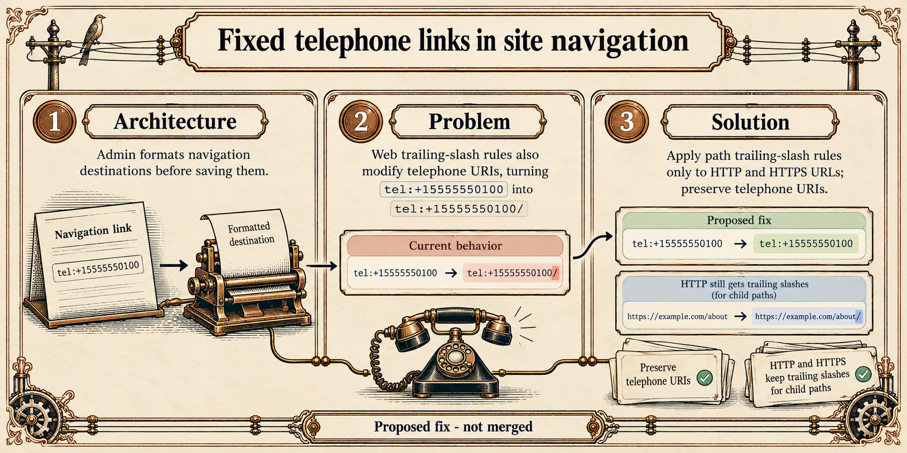

# B5: Telephone links in site navigation

**Architecture:** Admin formats navigation destinations before saving them.

**Problem:** The automatic trailing-slash rule also changes telephone URIs, so `tel:+15555550100` becomes `tel:+15555550100/`.

**Proposed solution:** Apply automatic trailing slashes only to HTTP and HTTPS URLs, preserving telephone URIs and their extension parameters. The change is proposed and not merged.

**Validation shown:** Telephone URI and extension examples, plus an HTTP child-path control. The infographic describes proposed checks, not a completed test run.
