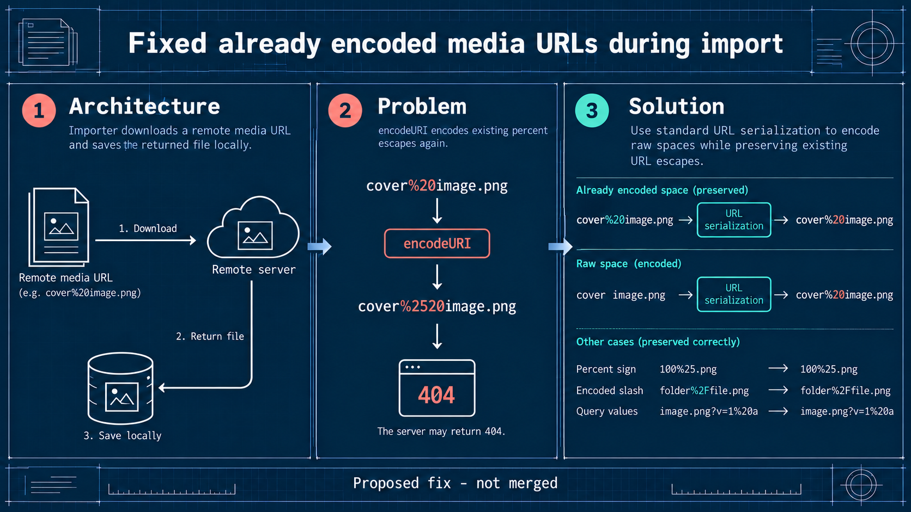

# B6: Double-encoded media URLs

## Current validation

- Focused media-inliner tests: **58 passed**. From `ghost/`: `pnpm exec vitest run test/unit/server/services/media-inliner/test/external-media-inliner.test.js --maxWorkers=1 --no-file-parallelism`.
- PR: [#32142](https://github.com/TryGhost/Ghost/pull/32142).
- Full `pnpm check`: attempted, exited 130 after formatting/Oxlint passed; Nx lint/build tasks failed on this Windows environment. The full test stage was not reached. See the PR and the validation archive for details. Product CI and migration staging review remain unverified.

> **Historical generation record:** The content below records the image-generation context and status at that time. Any test-status statement below is superseded by Current validation above; the generation prompts are preserved unchanged.

This native imagegen edit is a conceptual diagram, not a UI screenshot. The proposed fix is not merged.

The importer downloads a remote media URL and saves the returned file locally. Applying encodeURI to a URL that already contains a percent escape can turn %20 into %2520, causing the request to miss the expected path and return 404. The proposed URL serialization encodes raw spaces while preserving existing valid escapes.

The misleading Unicode row was removed. The remaining examples show existing encoded values retained, raw spaces encoded, and percent-sign, encoded-slash, and query-value cases preserved. The reproduction used a local loopback fixture; it did not contact a public server.

Theme brief: blueprint, generated with scripts/pr_infographic_prompt.py.

Prompt used for the native imagegen edit:

Use case: infographic-diagram. Asset: Ghost PR infographic. Theme: engineering blueprint with deep navy, crisp white technical lines, coral and teal highlights. Preserve the wide three-panel layout, title, architecture, problem, solution, and footer. In the Solution panel, remove the entire row labeled "Unicode" and its example/result; keep the percent-sign, encoded-slash, and query-value rows unchanged. Keep both examples showing that existing %20 escapes remain %20, while a raw space becomes %20. Preserve the rest of the original wording and composition. No new examples, labels, logos, or claims. Footer remains "Proposed fix - not merged".
