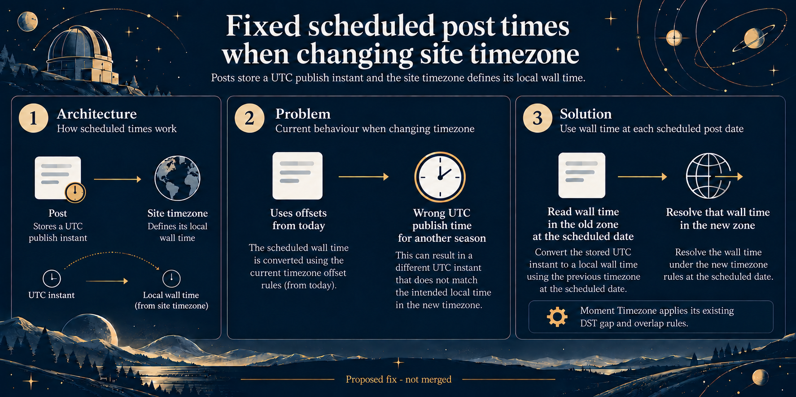

# B7: Scheduled-post timezone conversion

## Current validation

- Focused scheduled-post listener test: **1 passed**. From `ghost/`: `pnpm exec vitest run test/unit/server/models/base/listeners.test.js --maxWorkers=1 --no-file-parallelism`.
- PR: [#32148](https://github.com/TryGhost/Ghost/pull/32148).
- Full `pnpm check`: attempted, exited 130 after formatting/Oxlint passed; Nx lint/build tasks failed on this Windows environment. The full test stage was not reached. See the PR and the validation archive for details. Product CI and migration staging review remain unverified.

> **Historical generation record:** The content below records the image-generation context and status at that time. Any test-status statement below is superseded by Current validation above; the generation prompts are preserved unchanged.

This native imagegen edit is a conceptual diagram, not a UI screenshot. The proposed fix is not merged.

Scheduled posts store a UTC publish instant, and the site timezone determines its local wall time. The current listener applies an offset difference from the timezone-change date to every scheduled post, which can produce the wrong UTC publish time for a post in another daylight-saving season.

The proposed approach reads each post's local wall time in the old timezone at that post's scheduled date, then applies that wall time in the new timezone. Moment Timezone retains its existing resolution rules for nonexistent and ambiguous daylight-saving times; the diagram does not promise that a wall time inside a spring gap remains exact.

The reproduction invoked the real listener with synthetic models, a fake event emitter, and a fixed clock. It checked values submitted to Post.edit; it did not write to a database or publish a post. The regression test has not been run.

Theme brief: astronomy, generated with scripts/pr_infographic_prompt.py.

Prompt used for the native imagegen edit:

Use case: infographic-diagram. Asset: Ghost PR infographic. Theme: astronomical observatory chart with midnight blue, ivory, muted gold, and sparse orbital details. Preserve the wide composition, title, Architecture panel, margins, and footer. Correct Problem and Solution panels to state the actual rescheduler behavior. In Problem, replace the current diagram/text with the concise flow: "Uses offsets from today" → "Wrong UTC publish time for another season". Do not claim the stored UTC instant stays the same. In Solution, show: "Read wall time in the old zone at the scheduled date" → "Set that wall time in the new zone". Add a small accurate note: "Moment Timezone applies its existing DST gap and overlap rules." Remove the seasonal clock examples. Do not show dates or example timestamps, and do not promise that a nonexistent spring-gap time remains exactly the same. Use simple neutral clocks and arrows. Keep all text readable and the footer "Proposed fix - not merged".
Final text refinements applied to the saved image:

Use case: a precise final wording correction to the existing Ghost PR infographic. Preserve the astronomy theme and all composition, title, panel 1, panel 2, other solution text, icons, and footer. In the Solution panel only, replace "Set that wall time in the new zone" with exactly "Resolve that wall time in the new zone". Replace the paragraph "Convert that same local wall time to a UTC instant using the new timezone at the scheduled date." with exactly "Resolve the wall time under the new timezone rules at the scheduled date." Keep the note that Moment Timezone applies its existing DST gap and overlap rules. Do not imply that a nonexistent spring-gap time can remain exact.

Use case: precise-object-edit of infographic text. The local image is the edit target. Preserve this astronomy-themed infographic exactly except for one subtitle in the Solution panel. Replace the line "Keep the same local wall time in the new timezone" with exactly "Use wall time at each scheduled post date". Do not change the title or any other text or graphic. Keep the existing solution statement that the new timezone rules resolve wall time at the scheduled date, and keep the note about Moment Timezone DST gap and overlap rules.
