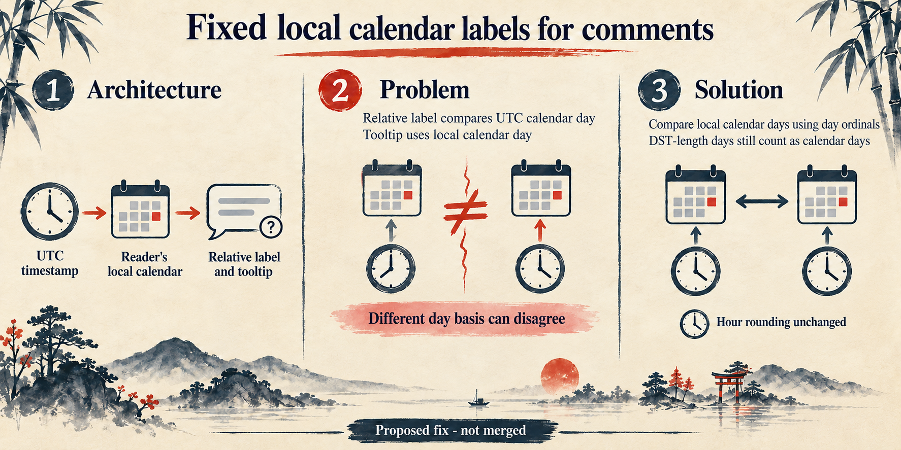

# B8: Comment relative dates and local calendar days

This native imagegen edit is a conceptual diagram, not a UI screenshot. The proposed fix is not merged.

The relative comment label currently compares UTC calendar dates, while the tooltip uses the reader's local calendar. Those date bases can disagree near timezone boundaries. The proposed helper compares local calendar days using day ordinals; relative-hour rounding remains unchanged, including across 23-hour and 25-hour daylight-saving days.

The infographic uses abstract calendar and clock symbols only. It contains no product logos, interface mockups, sample dates, timestamps, or Today/Yesterday labels.

The helper and tooltip formatter were exercised under fixed clocks and timezones. The Comments UI was not booted in a browser, and the proposed regression tests have not been run.

Theme brief: washi, generated with scripts/pr_infographic_prompt.py.

Prompt used for the native imagegen edit:

Use case: infographic-diagram. Asset: Ghost PR infographic. Theme: Japanese sumi-e on warm washi, indigo and vermilion, quiet bamboo margins, no kanji. Rebuild the three numbered panel interiors as an abstract conceptual diagram while preserving the wide layout, title, washi paper, decorative margins, and footer. Remove every GitHub or other logo, miniature UI/card, sample date, timestamp, and sample relative label. Do not show the word "Today" or "Yesterday". Use only simple calendar and clock symbols without numerals. Architecture panel text: "UTC timestamp" → "Reader's local calendar" → "Relative label and tooltip". Problem panel text: "Relative label compares UTC calendar day" and "Tooltip uses local calendar day" → "Different day basis can disagree". Solution panel text: "Compare local calendar days using day ordinals" and "DST-length days still count as calendar days"; small note: "Hour rounding unchanged". Keep labels exactly as written, readable, and factual. Footer: "Proposed fix - not merged".
