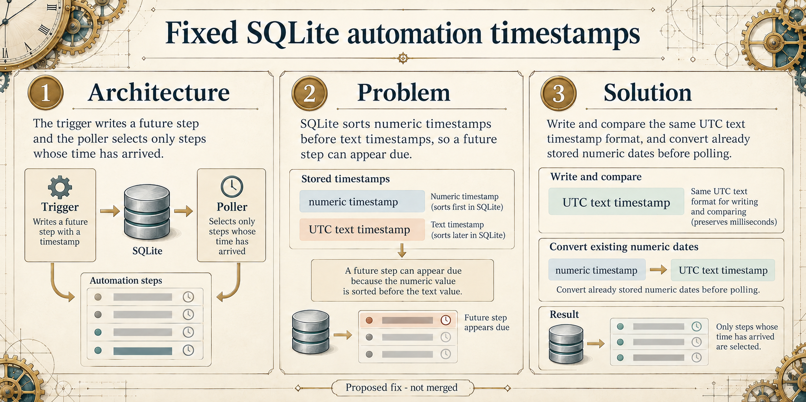

# C1: SQLite automation timestamps

## Current validation

- Focused private in-memory SQLite validation: **104 passed across 2 test files**. From `ghost/`: `pnpm exec vitest run --config .c1-vitest.config.ts --maxWorkers=1 --no-file-parallelism`.
- PR: [#32151](https://github.com/TryGhost/Ghost/pull/32151).
- No live MySQL migration or production database was tested. Full `pnpm check` and upstream CI: pending.

> **Historical generation record:** The content below records the image-generation context and status at that time. Any test-status statement below is superseded by Current validation above; the generation prompt is preserved unchanged.

**Architecture:** The automation trigger writes the next step and its `ready_at` time. The poller reads steps whose deadline has arrived.

**Problem:** SQLite sorts numeric values before text values, so mixing numeric and text timestamps can make a future step look due.

**Solution:** The proposal stores and compares millisecond-precision UTC text timestamps on SQLite and converts existing numeric timestamps during migration. MySQL keeps its existing `Date` bindings. This proposal is not merged; the proposed SQLite integration test and full validation remain pending.

The corrected image uses only the generic labels “numeric timestamp” and “UTC text timestamp”. It contains no sample values or claimed conversion result.

## Image generation record

- Edited the existing clockwork-themed infographic with the native `image_gen.imagegen` tool.
- Before the native edit, ran `python scripts/pr_infographic_prompt.py --title "Keep SQLite automation timestamps comparable" --summary "Automation repository 2 stores run and step dates as numeric timestamps on SQLite, while the poller compares ready_at with a text timestamp. SQLite sorts numeric values before text, so a future wait can appear due. The proposed fix writes millisecond-precision UTC text timestamps, compares using the same representation, and migrates existing numeric timestamps idempotently; MySQL Date bindings remain unchanged." --docs "Proposed fix, not merged. The proposed in-memory SQLite integration test checks the migration, stored timestamp types, and exclusion of a future ready_at. Tests have not been run. Show only the labels numeric timestamp and UTC text timestamp; include no sample numbers, dates, times, or conversions." --theme clockwork --json`.

Native edit prompt:

> Use case: infographic-diagram
> Asset type: Ghost pull request infographic edit
> Input image: the current C1 infographic is the edit target. Preserve its precision clockmaker notebook theme, ivory paper, graphite, brass and teal palette, restrained gear margins, wide composition, three numbered panels, headings, arrows, and footer.
>
> Primary request: Correct the timestamp examples so the diagram does not claim a false numeric-to-date conversion or an ISO format. Keep the simple architecture/problem/solution story accurate.
>
> In every panel, remove every specific timestamp number, date, time, ISO string, and sample conversion, including the shown integer and date-time example. Use only the exact generic labels “numeric timestamp” and “UTC text timestamp” wherever the two representations need naming. Do not replace them with another value or a literal date format. Do not show a sample value-to-value conversion.
>
> Keep the factual flow: a trigger writes a future automation step; SQLite sorts numeric values before text, which can make a future step appear due; the proposed fix stores and compares the same millisecond-precision UTC text representation and migrates existing numeric timestamps. Keep the MySQL behavior out of the visual if it does not fit.
>
> Preserve the three-panel layout and the footer “Proposed fix - not merged”. Make all text crisp, large, and readable. Do not add new claims, dates, numbers, formats, logos, mascots, watermarks, or UI elements.
