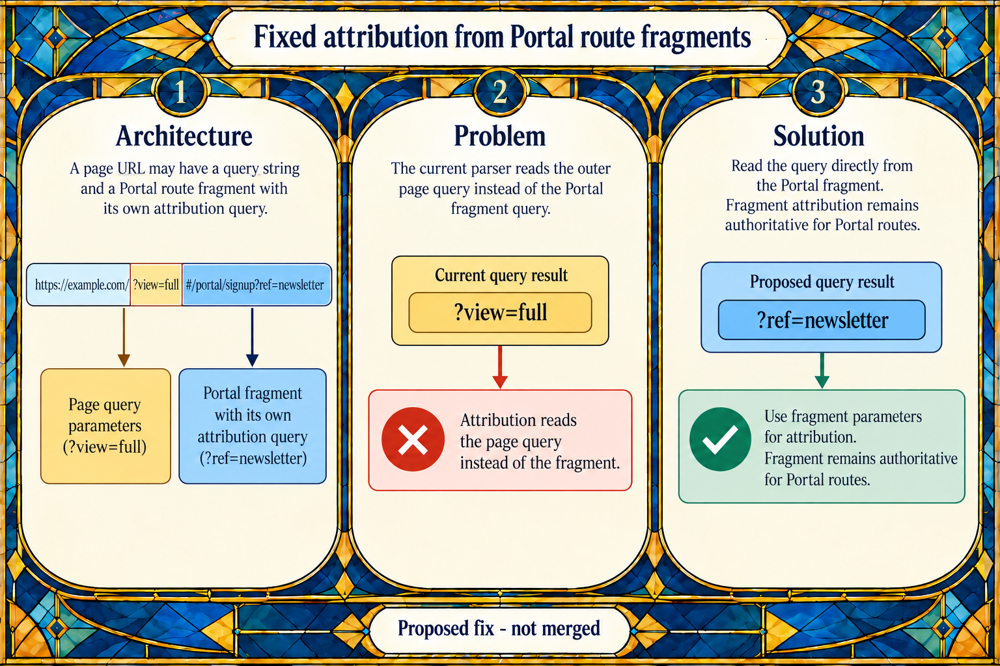

# C2: Portal attribution from the route fragment

**Architecture:** The page URL can contain an outer query and a separate Portal route fragment. The attribution parser needs to read the Portal fragment’s query for Portal routes.

**Problem:** In the exact example `https://example.com/?view=full#/portal/signup?ref=newsletter`, the current parser reads `?view=full` instead of the Portal fragment’s `?ref=newsletter`.

**Solution:** The proposal reads query parameters directly from the Portal fragment, so its `ref` remains authoritative. C2 is a static candidate; no runtime reproduction or proposed regression test has been run. The image shows only the supplied URL and the current and proposed query results.

## Image generation record

- Edited the existing stained-glass infographic with the native `image_gen.imagegen` tool. The second edit removed the extra validation strip and its additional URL examples; the third changed “campaign parameters” to “attribution query”.
- Before each native edit, ran `python scripts/pr_infographic_prompt.py --title "Fixed Portal attribution parsing when a page query is present" --summary "Portal attribution should come from the query inside the Portal route fragment. With the exact input https://example.com/?view=full#/portal/signup?ref=newsletter, the current parser reads the outer query ?view=full instead of the fragment query ?ref=newsletter. The proposed fix reads URLSearchParams directly from the Portal fragment." --docs "Proposed fix, not merged. C2 is a static candidate; no runtime reproduction or proposed tests have been run. Show only this one exact input URL: https://example.com/?view=full#/portal/signup?ref=newsletter. Label the current query ?view=full and the proposed correct query ?ref=newsletter. Use only the actual ref field; include no UTM names or values, no extra parameters, and no rewritten or combined URL." --theme glass --json`.

Native edit prompts, in order:

> Use case: infographic-diagram
> Asset type: Ghost pull request infographic edit
> Input image: the current C2 infographic is the edit target. Preserve its Art Deco stained-glass framing, ivory central panels, jewel-blue and amber palette, wide layout, three numbered panels, and footer.
>
> Primary request: simplify the diagrams and correct the URL example. Keep only one complete input URL, exactly:
> “https://example.com/?view=full#/portal/signup?ref=newsletter”
>
> Architecture panel: show that exact input once, with the outer page query and Portal route fragment visually distinguished. Do not add any URL example elsewhere.
>
> Problem panel: show only the current query result “?view=full” and explain that the current parser reads the outer page query instead of the Portal fragment query.
>
> Solution panel: show only the proposed query result “?ref=newsletter” and explain that the fix reads the query directly from the Portal fragment.
>
> Use only the actual field name ref. Do not show utm, blue, or any other campaign field/value. Do not show a rewritten, stripped, concatenated, or second full URL. Do not add any other query parameter. Keep all URL punctuation exact where it appears. Preserve the three-panel architecture/problem/solution structure, large readable English labels, and footer “Proposed fix - not merged”. No invented examples, extra claims, logos, mascots, or watermarks.

> Use case: infographic-diagram
> Asset type: Ghost pull request infographic edit
> Input image: the current corrected C2 infographic is the edit target. Preserve its Art Deco stained-glass style, blue-and-amber frame, ivory panels, three numbered architecture/problem/solution panels, and bottom footer.
>
> Primary request: remove the extra examples below the three main panels. Delete the entire “Validation and context” strip and all of its five mini-cards. Extend the three main panels vertically if needed so the composition remains balanced, and retain the footer “Proposed fix - not merged”.
>
> Keep exactly one full input URL, in the Architecture panel only, spelled exactly:
> “https://example.com/?view=full#/portal/signup?ref=newsletter”
>
> In the Problem panel, show only the current query result “?view=full”. In the Solution panel, show only the proposed query result “?ref=newsletter”. The Architecture panel may visually label the two parts “page query” and “Portal fragment”.
>
> Use only the actual field name ref. Do not show utm, blue, or any other campaign field/value. Do not show another URL, a rewritten or combined URL, any extra query parameter, or any additional test-case examples. Preserve the existing factual explanation and readable large type. No new claims, logos, mascots, or watermarks.

> Use case: infographic-diagram
> Asset type: Ghost pull request infographic edit
> Input image: the current C2 infographic is the edit target. Preserve the stained-glass style, three main panels, the single exact URL, all query examples, and the footer.
>
> Change only one phrase in the Architecture panel. Replace “its own campaign parameters” with the exact wording “its own attribution query”. Keep all other text, URL punctuation, colors, layout, arrows, and panels unchanged.
>
> Do not add or remove any URL or query parameter. Continue to show only the exact input URL https://example.com/?view=full#/portal/signup?ref=newsletter, the current query result ?view=full, and the proposed query result ?ref=newsletter. Do not show utm or any field except ref. Preserve the footer “Proposed fix - not merged”.
