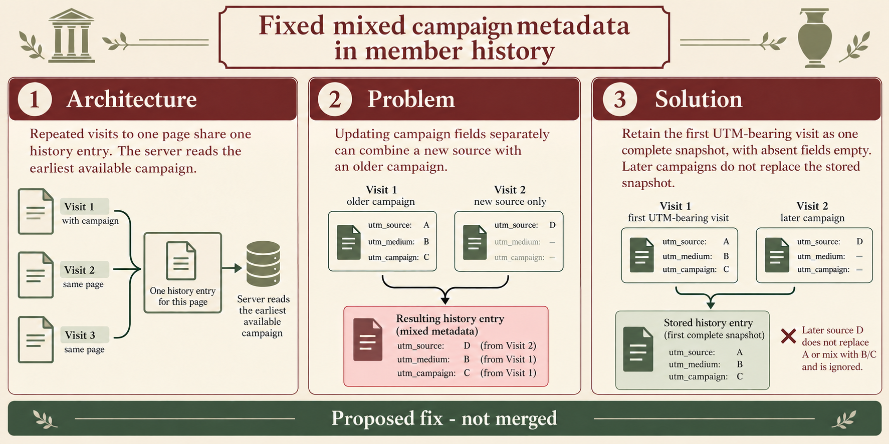

# C3: Keep the first UTM snapshot in member history

**Architecture:** Repeated visits to one pathname share a history entry, which the server later reads for member attribution.

**Problem:** The current code updates each truthy UTM field independently, so a later source can combine with the medium and campaign from an earlier visit.

**Solution:** The proposal keeps the first UTM-bearing visit as one complete five-field snapshot, including empty values for omitted fields. In the illustration, the first visit supplies A/B/C and a later campaign supplies source D; the stored entry keeps A/B/C. One Node VM reproduction confirmed the mixed values, but the proposed regression test and full Ghost Core unit suite have not been run. The proposal is not merged.

## Image generation record

- Edited the existing archival index-card infographic with the native `image_gen.imagegen` tool. A second native edit replaced the confusing “no campaign yet” wording with “Later campaigns do not replace the stored snapshot.”
- Before each native edit, ran `python scripts/pr_infographic_prompt.py --title "Changed member history to retain the first UTM snapshot" --summary "Repeated visits to one pathname share a history entry. The current code updates each truthy UTM field separately, so a later campaign can combine its utm_source with the earlier visit's utm_medium and utm_campaign. The proposed fix stores the first UTM-bearing visit as one complete five-field snapshot and keeps later visits from mixing values into it." --docs "One Node VM reproduction confirmed the mixed UTM fields. The proposed regression test and full Ghost Core unit suite have not been run. In the solution panel show Visit 1 fields utm_source A, utm_medium B, utm_campaign C; Visit 2 as a later campaign with utm_source D and other UTM fields empty; and the stored entry preserving original A/B/C. Remove the unclear dashed side example." --theme archive --json`.

Native edit prompts, in order:

> Use case: infographic-diagram
> Asset type: Ghost pull request infographic edit
> Input image: the current C3 infographic is the edit target. Preserve its museum archival index-card style, cream background, maroon and sage palette, wide layout, three numbered panels, typography, and footer.
>
> Primary request: Correct only the Solution panel so it shows a later campaign being ignored by an entry that already holds the first campaign snapshot.
>
> Keep the Solution panel’s core description: “Retain the first UTM-bearing visit as one complete snapshot, with absent fields empty.” Replace any wording that says Visit 2 has “no campaign yet”. Label Visit 2 “later campaign” and show utm_source: D, utm_medium: —, utm_campaign: —. Show the stored history entry unchanged with utm_source: A, utm_medium: B, utm_campaign: C. Make clear that the later source D does not replace A or mix with B/C. Remove the faded dashed side example, its connector, and its mini-card entirely.
>
> Keep Visit 1 labeled as the first UTM-bearing visit with source A, medium B, campaign C. Leave Architecture and Problem panels unchanged. Do not add any other UTM values or extra fields. Preserve the footer “Proposed fix - not merged”. Keep text crisp and readable, with no new claims, dates, logos, or watermarks.

> Use case: infographic-diagram
> Asset type: Ghost pull request infographic edit
> Input image: the current C3 infographic is the edit target. Preserve its museum archival index-card style, cream background, maroon and sage palette, wide layout, three numbered panels, typography, and footer.
>
> Primary request: make the Solution panel’s explanation consistent with its later-campaign example.
>
> Keep this sentence exactly: “Retain the first UTM-bearing visit as one complete snapshot, with absent fields empty.” Replace the next sentence about capturing a visit only when no campaign exists with this exact sentence: “Later campaigns do not replace the stored snapshot.” Do not use the phrase “no campaign yet” anywhere.
>
> Keep Visit 1 labeled “first UTM-bearing visit” with utm_source A, utm_medium B, utm_campaign C. Keep Visit 2 labeled “later campaign” with utm_source D, utm_medium —, utm_campaign —. Keep the stored history entry unchanged with utm_source A, utm_medium B, utm_campaign C. Keep the note that later source D does not replace A or mix with B/C. The faded dashed side example is already removed; do not reintroduce it.
>
> Leave Architecture and Problem panels unchanged. Preserve the footer “Proposed fix - not merged”. No extra UTM values or claims, dates, logos, or watermarks. Keep the text crisp and readable.
