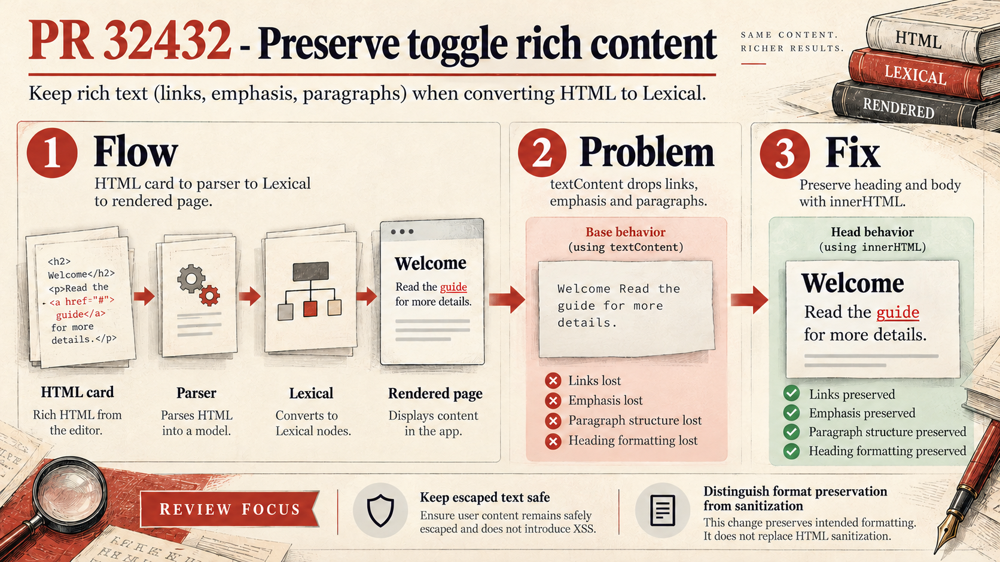
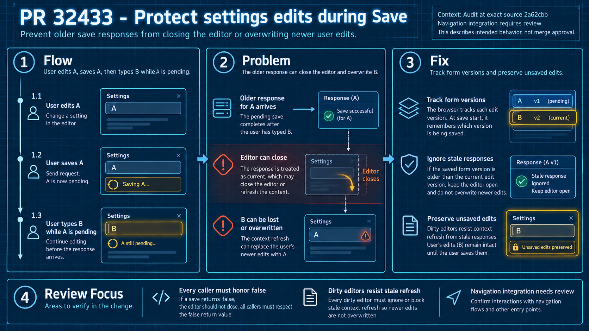
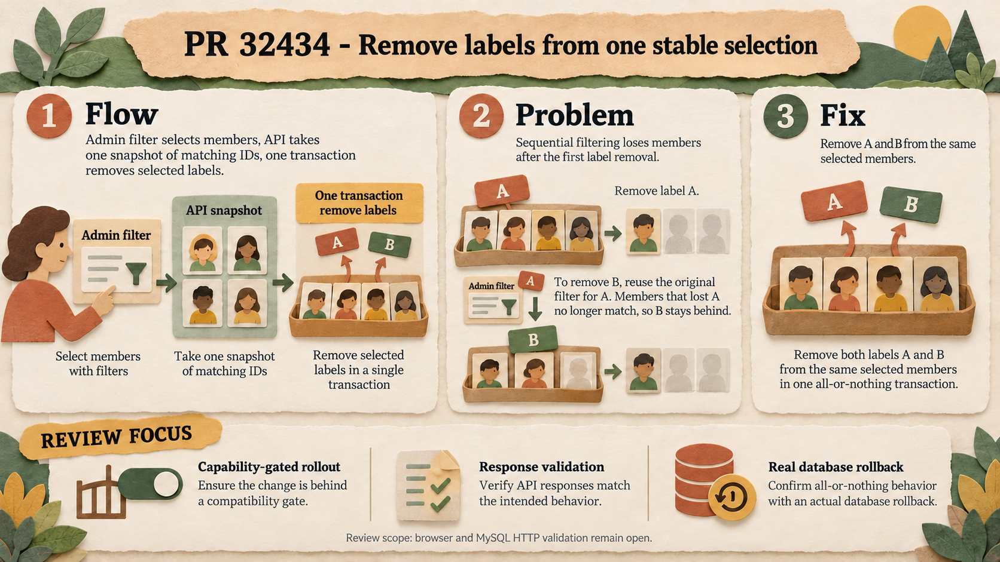

# Ghost PR review — visual explanations

These diagrams show architecture, the original problem and the intended fix. The accompanying audits describe remaining defects and test limits. They are not approval badges.

## PR #32432 — Toggle import

[Conceptual explanation](pr-32432/infographic_report.md) · [Audit: imported inline spacing in email](pr-32432/audit.md).

## PR #32433 — Settings saves

[Conceptual explanation](pr-32433/infographic_report.md) · [Audit: shared-hook consumers](pr-32433/audit.md).

## PR #32434 — Bulk labels

[Conceptual explanation](pr-32434/infographic_report.md) · [Audit: contract, scale and rollout](pr-32434/audit.md).

