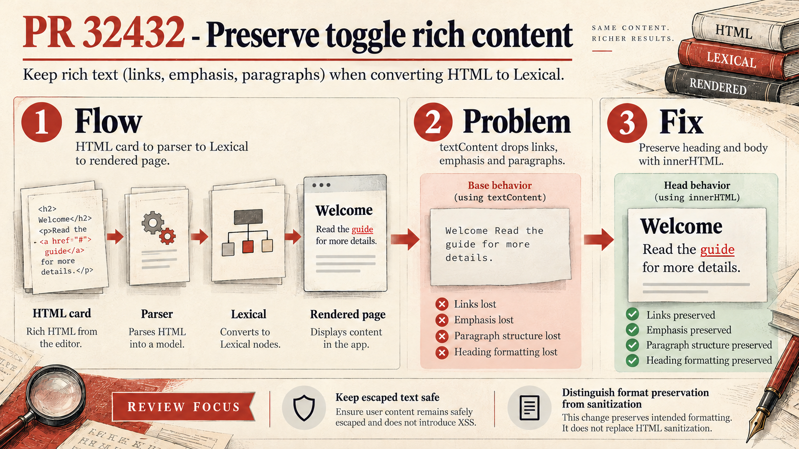

# PR #32432: preserve toggle formatting, check email output

The import parser takes a toggle's heading and body from HTML and stores them in a Lexical document. The web and email renderers later turn that document into different HTML outputs. The original parser kept only text, dropping formatting and links; the PR preserves the inner HTML instead.

The intended web behavior works in the focused audit. A newly exposed email defect remains: adjacent formatted words such as **Hello** *world* lose their separating space in the email template. The old whitespace helper already had that defect for rich Lexical input; this PR exposes it to the same imported HTML that previously rendered separated words.

The infographic explains the intended fix, not complete acceptance. Read the [audit and base/head evidence](audit.md) before treating the right-hand panel as a statement about email output. The small source-page illustration is schematic, not an executable fixture. Arbitrary HTML and editor-supported rich text are different contracts.

Validation: eight behavioral scenarios passed on each revision, including checks that explicitly record the defect. No actual email delivery or browser E2E is claimed. Native image generation, prompt and technical corrections are recorded in [image-generation.md](image-generation.md) and [infographic_prompt.json](infographic_prompt.json).

