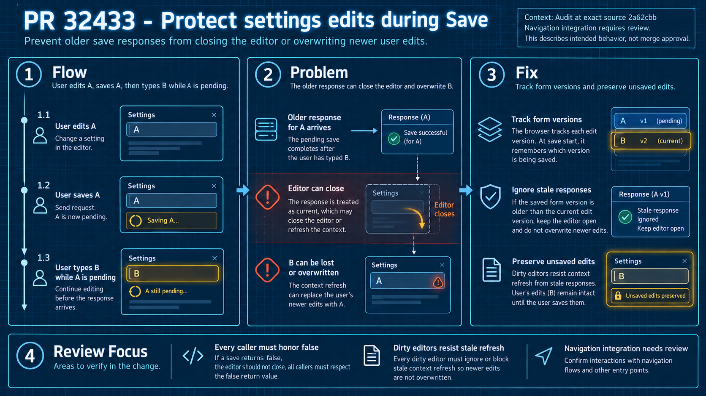

# PR #32433: a completed save must not acknowledge a newer edit

The browser sends settings A, then the user types B before A finishes. The shared hook remembers the local edit version at save start. It can then report that A finished without falsely marking B saved. This is browser bookkeeping; the server does not return a version token.

The intended behavior also depends on callers. A modal must respect a false save result, and refresh handlers must not replace dirty state. The audit confirms that the ordinary editing group benefits, while a modeled unguarded modal callback can close after a rejected second Save. The actual Design hook can still replace B with response A; that overwrite existed at the base.

The infographic shows the intended contract and remaining integration work. See the [independent audit](audit.md) for exact source references and the [validation record](validation.md) for eight passing head/base probes. These use real hooks with controlled API/context dependencies; the full modal/router/browser stack was not executed.

Native generation, original prompt and technical corrections: [image-generation.md](image-generation.md), [infographic_prompt.json](infographic_prompt.json). The previous PR's 28 focused tests are historical author-reported evidence, not reruns in this audit.

