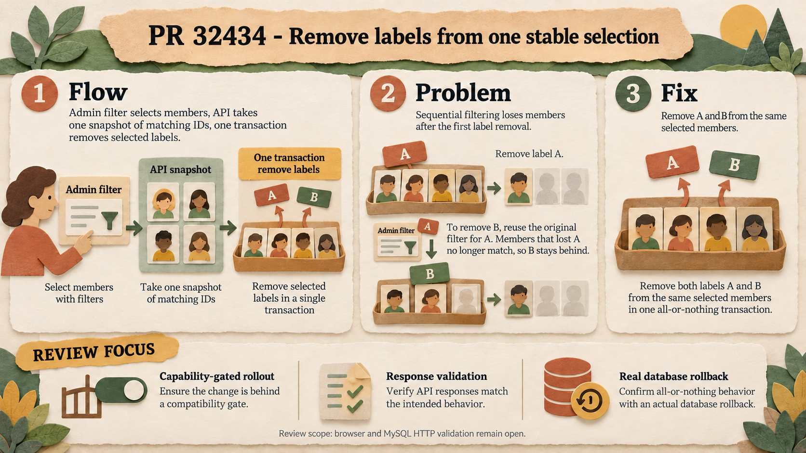

# PR #32434: keep the member selection stable while removing labels

Admin chooses members using a filter, such as label A. Previously it sent one request to remove A and another to remove B, each using the same original filter for A. Once A was removed, the second request no longer found those members and B remained.

The new Core action selects matching member IDs once and removes the requested label relations in a transaction. Admin enables multiple labels only when Core advertises the capability; older Core retains the single-label flow. The snapshot is taken when the request runs, not when the modal opens.

The isolated probe confirmed the selection correction and restoration of all 102 relations after a later delete-chunk failure. It also found a narrow SQLite bind-limit regression with large selections and a response/type mismatch: the new type requires an action field that the existing serializer omits. Stats count relation IDs, not distinct members.

The illustration describes the design, not an all-environments approval. Read the [audit, contract details and limitations](audit.md) and [probe](behavior_probe.py). Browser acceptance and MySQL/HTTP validation remain open. Prompt and technical corrections: [image-generation.md](image-generation.md), [infographic_prompt.json](infographic_prompt.json).

