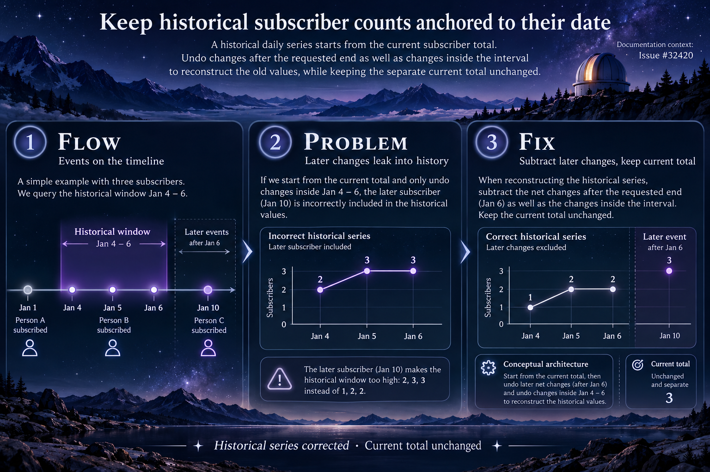

# Historical subscriber counts

Issue: https://github.com/TryGhost/Ghost/issues/32420

## Architecture, problem and solution

The daily subscriber series is reconstructed from the current subscriber total and subscription events. For an old end date, changes after that end must also be undone. The fix aggregates those later net changes using the same resolved date boundary and newsletter/member eligibility filters. Historical values are corrected while the separate current total stays current. This concerns historical date ranges accepted by the API; ordinary UI presets ending today are not claimed to show the old-end-date scenario.

## Illustration

Theme: Observatory timeline. This is conceptual documentation rather than a screenshot or evidence of a test result.

Generated with the native image generation tool and visually inspected. The prompt helper ran directly with Python. See [prompt inputs](prompt.json), [generation instructions](generation-prompt.txt), and [validation results](results.md).
