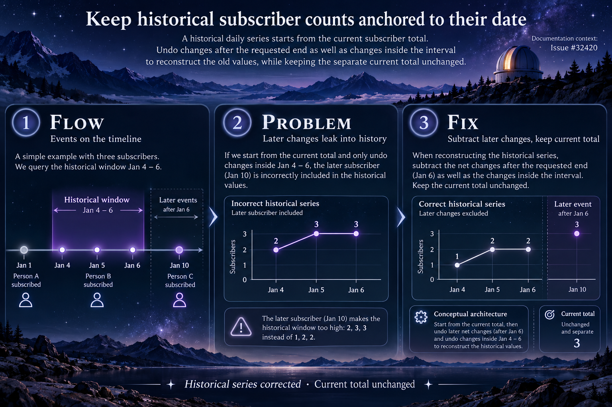

Fixes https://github.com/TryGhost/Ghost/issues/32420

Requesting newsletter subscriber history with an end date in the past reconstructs that series from today's total without undoing later subscriptions and cancellations. Those later events incorrectly change the old series.

Subtract the net changes after the resolved end boundary when reconstructing the daily values. Apply the same newsletter and email-disabled-member filters, include events exactly at the requested end in the range, and preserve the separate current total. Requests without `date_to` do not perform the additional query. Existing UTC date grouping and day filling are unchanged.

Validation:
- Four historical-value regressions failed against the original implementation, covering later subscriptions, later cancellations, a range without events and a timezone boundary.
- All 56 tests in the official stats service test file passed with Node 22.23.4 and Vitest 4.1.12, one worker in an isolated sandbox. Coverage includes the current total, omitted `date_to`, newsletter filtering, disabled email and the inclusive end boundary.
- These tests exercise SQLite. MySQL, the full HTTP path and browser behavior have not been validated. This addresses historical ranges accepted by the API; ordinary UI presets ending today are not claimed to reproduce the old-end-date case.
- The batch's representative `pnpm check` reached its 180-second limit in formatting (exit 124), before lint or the full test stage. No full repository pass is claimed.
- Retested the final commit on 1 November: 56/56 passed with exit 0. See the [resumed validation report](https://github.com/JoaoMarcos44/Ghost/blob/docs/functional-fixes-20261031/reports/ghost-prs-2026-10-31-followup/validation/resume-tests.md).

[Evidence and commands](https://github.com/JoaoMarcos44/Ghost/blob/592b7186cb503946ebd298b03433d3e6f61cd243/reports/ghost-prs-2026-10-31-followup/history/results.md) · [Visual explanation](https://github.com/JoaoMarcos44/Ghost/blob/592b7186cb503946ebd298b03433d3e6f61cd243/reports/ghost-prs-2026-10-31-followup/history/infographic_report.md)

Infographic — observatory timeline

- [x] I've read and followed the [Contributor Guide](https://github.com/TryGhost/Ghost/blob/main/.github/CONTRIBUTING.md)
- [x] I've explained my change
- [x] I've written an automated test to prove my change works

Draft as requested; broader validation and maintainer review remain outstanding.
