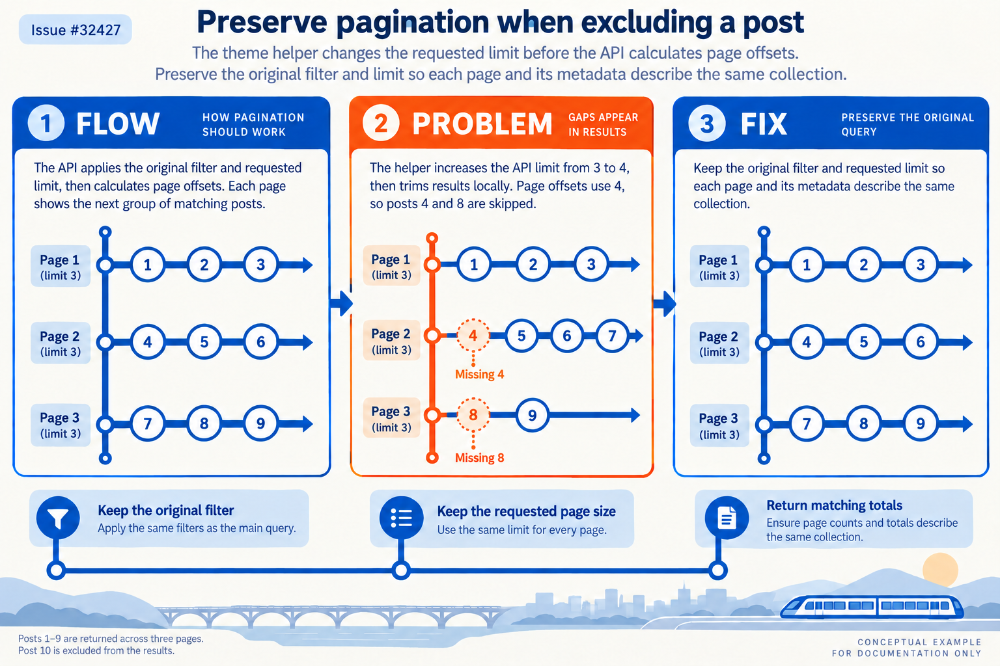
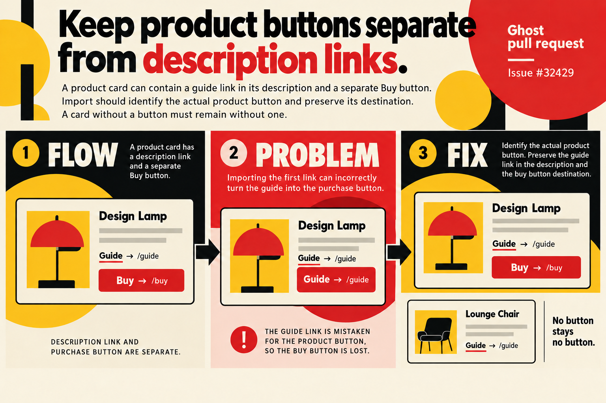
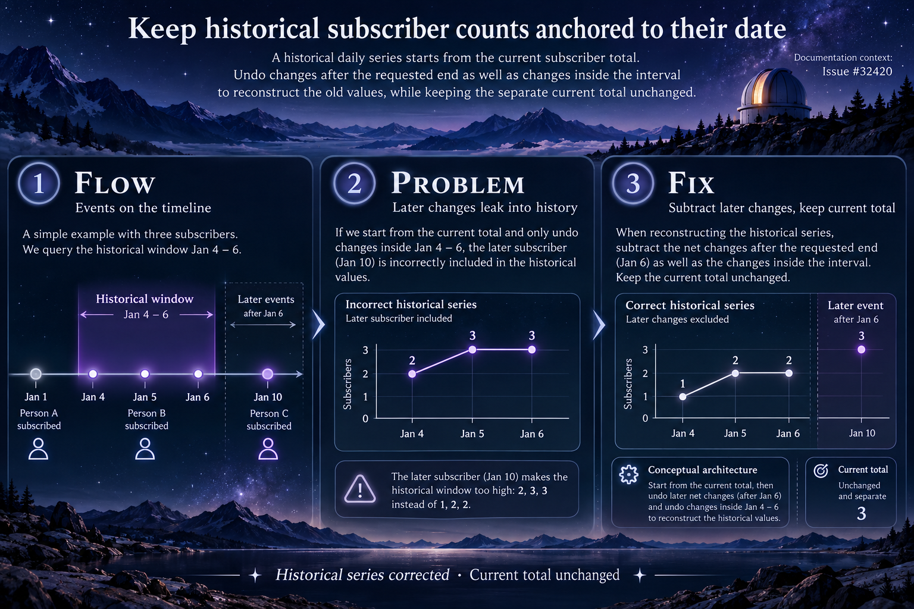

# Remaining Ghost fixes: visual documentation

The user authorized draft PRs for all three remaining confirmed issues, extending the earlier three-PR batch. Each uses a distinct theme and keeps its generated graphics outside the source diff.

## Pagination — transit map

[Issue #32427](https://github.com/TryGhost/Ghost/issues/32427) · [Explanation and evidence](pagination/infographic_report.md).

## Product card — Bauhaus poster

[Issue #32429](https://github.com/TryGhost/Ghost/issues/32429) · [Explanation and evidence](product/infographic_report.md).

## Subscriber history — observatory timeline

[Issue #32420](https://github.com/TryGhost/Ghost/issues/32420) · [Explanation and evidence](history/infographic_report.md).

All images were generated natively and inspected. The pagination wording was corrected to say the API limit increases; the product illustration was corrected to show that the original description link remains. These illustrations do not replace execution evidence. Final validation and publication status are recorded in the [main report](README.md).
