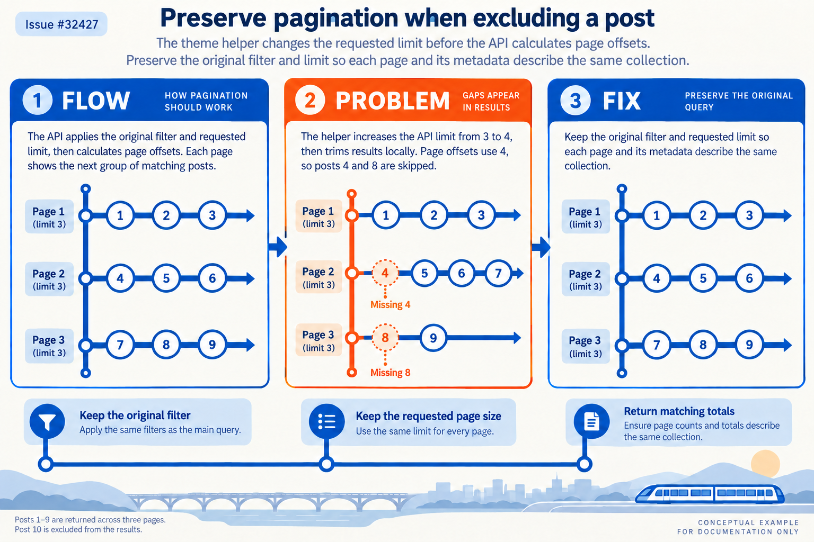

# Pagination with excluded posts

Issue: https://github.com/TryGhost/Ghost/issues/32427

## Architecture, problem and solution

The theme helper delegates filtering and pagination to the API. Increasing the API limit and removing an ID afterward changes the offset between pages and leaves pagination metadata describing a different collection. The fix forwards the original filter and limit. Identical queries still deduplicate within a request; different excluded IDs no longer share the removed shortcut’s normalized cache key. Its performance impact has not been measured.

## Illustration

Theme: Transit map. This is conceptual documentation rather than a screenshot or evidence of a test result.

Generated with the native image generation tool and visually inspected. The prompt helper ran directly with Python. See [prompt inputs](prompt.json), [generation instructions](generation-prompt.txt), and [validation results](results.md).
