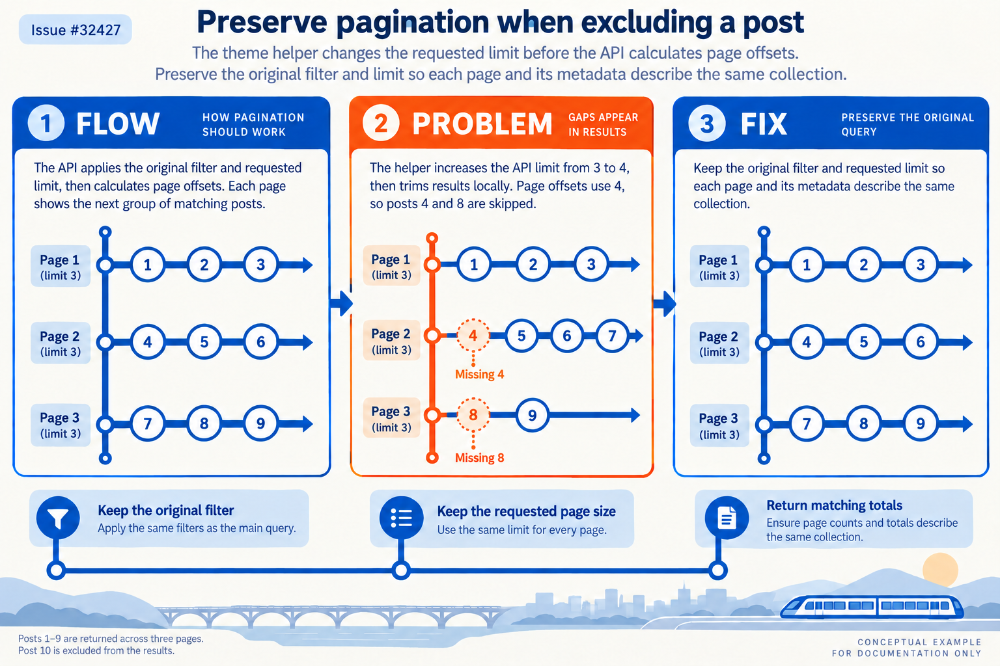

Fixes https://github.com/TryGhost/Ghost/issues/32427

With an excluded post ID, the `get` helper increases the API limit and removes the post afterward. Page offsets then skip posts, totals include the excluded post, and a field selection without `id` cannot remove it.

Pass the original filter and limit to the API, converting Handlebars SafeString filters to text. Identical queries still deduplicate within a request. Queries excluding different IDs no longer share the removed normalized cache key; the performance impact has not been benchmarked.

Validation:
- Nine regression cases failed against the original behavior. The corrected helper passed all 59 unit tests with Node 22.23.4 and Vitest 4.1.12, one worker in an isolated sandbox.
- Targeted ESLint and `git diff --check` passed. An existing error-handling test exceeded the original five-second timeout; the full file passed with a fifteen-second timeout.
- The API boundary is mocked in unit tests. The added/updated frontend E2E tests and MySQL path have not run.
- The batch's representative `pnpm check` reached its 180-second limit in formatting (exit 124), before lint or the full test stage. No full repository pass is claimed.
- Retested the final commit on 1 November: 59/59 passed with a 60-second per-test timeout. The first run passed 58/59 and timed out in the existing general-error-handling test at 15 seconds. See the [resumed validation report](https://github.com/JoaoMarcos44/Ghost/blob/docs/functional-fixes-20261031/reports/ghost-prs-2026-10-31-followup/validation/resume-tests.md).

[Evidence and commands](https://github.com/JoaoMarcos44/Ghost/blob/592b7186cb503946ebd298b03433d3e6f61cd243/reports/ghost-prs-2026-10-31-followup/pagination/results.md) · [Visual explanation](https://github.com/JoaoMarcos44/Ghost/blob/592b7186cb503946ebd298b03433d3e6f61cd243/reports/ghost-prs-2026-10-31-followup/pagination/infographic_report.md)

Infographic — transit map

- [x] I've read and followed the [Contributor Guide](https://github.com/TryGhost/Ghost/blob/main/.github/CONTRIBUTING.md)
- [x] I've explained my change
- [x] I've written an automated test to prove my change works

Draft as requested; broader validation and maintainer review remain outstanding.
