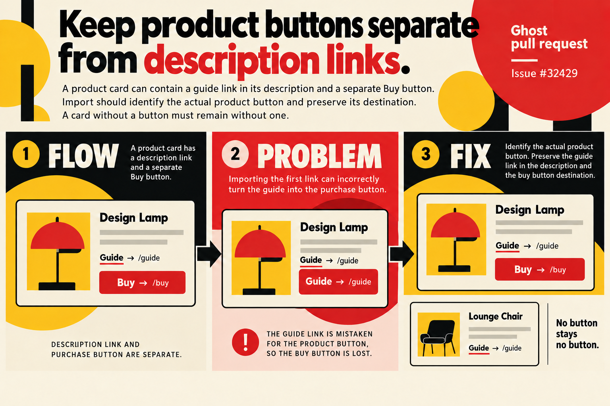

# Product buttons and description links

Issue: https://github.com/TryGhost/Ghost/issues/32429

## Architecture, problem and solution

A product card stores rich description HTML and a separate purchase button. Selecting the first anchor in the imported card can mistake a description link for that button. The parser now selects the button class emitted by current and legacy web renderers. It preserves both the description and the actual button, and keeps cards without buttons buttonless. Custom HTML omitting the expected button class is outside this renderer contract.

## Illustration

Theme: Bauhaus product poster. This is conceptual documentation rather than a screenshot or evidence of a test result.

Generated with the native image generation tool and visually inspected. The prompt helper ran directly with Python. See [prompt inputs](prompt.json), [generation instructions](generation-prompt.txt), and [validation results](results.md).
