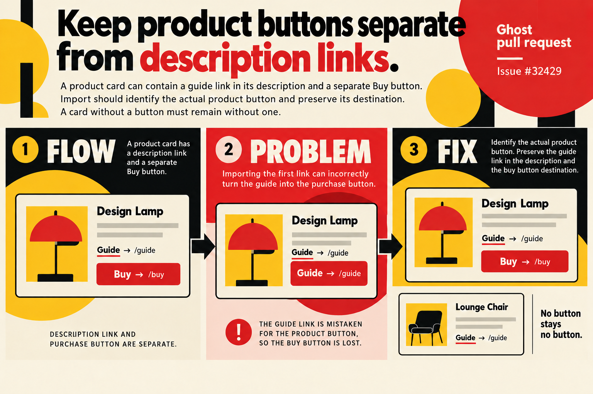

Fixes https://github.com/TryGhost/Ghost/issues/32429

A product description can contain a guide link before its purchase button. HTML import currently selects the first anchor, replacing the real button's text and destination with that description link, or creating a button when none existed.

Select `a.kg-product-card-button`, the class emitted by current and legacy web renderers. Preserve the description HTML and the presence or absence of the actual button. Includes a patch changeset for `@tryghost/kg-default-nodes`. Custom markup without that button class is outside this renderer contract.

Validation:
- Expected failures reproduced both wrong-button cases before the fix.
- All 30 product-node tests and 39 converter tests passed with Node 22.23.4/Vitest 4.1.12, in isolated sandboxes with one worker. Coverage includes rich descriptions, missing buttons, plain controls and render/import/render.
- Targeted ESLint and all commit hooks passed.
- The batch's representative `pnpm check` reached its 180-second limit in formatting (exit 124), before lint or the full test stage. Full repository, build/type and browser validation is not claimed.
- Retested the final commit on 1 November: 30/30 product-node tests and 39/39 converter tests passed. An initial wrapper parsing failure was caused by ANSI output after a successful 30-test run; it was corrected without changing the tests or source. See the [resumed validation report](https://github.com/JoaoMarcos44/Ghost/blob/docs/functional-fixes-20261031/reports/ghost-prs-2026-10-31-followup/validation/resume-tests.md).

[Evidence and commands](https://github.com/JoaoMarcos44/Ghost/blob/592b7186cb503946ebd298b03433d3e6f61cd243/reports/ghost-prs-2026-10-31-followup/product/results.md) · [Visual explanation](https://github.com/JoaoMarcos44/Ghost/blob/592b7186cb503946ebd298b03433d3e6f61cd243/reports/ghost-prs-2026-10-31-followup/product/infographic_report.md)

Infographic — Bauhaus product poster

- [x] I've read and followed the [Contributor Guide](https://github.com/TryGhost/Ghost/blob/main/.github/CONTRIBUTING.md)
- [x] I've explained my change
- [x] I've written an automated test to prove my change works

Draft as requested; broader validation and maintainer review remain outstanding.
