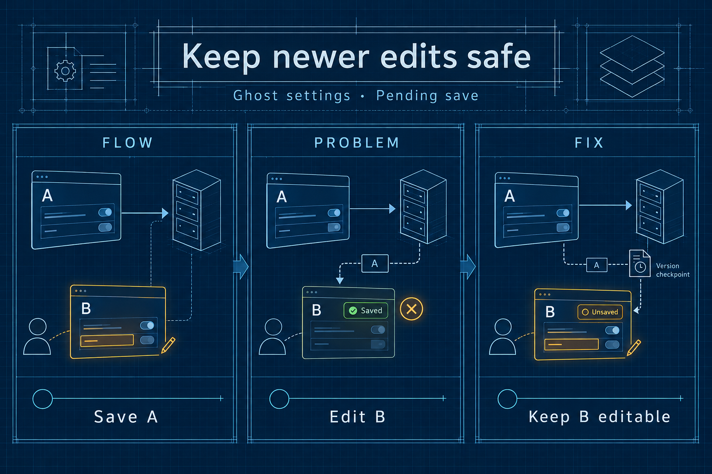
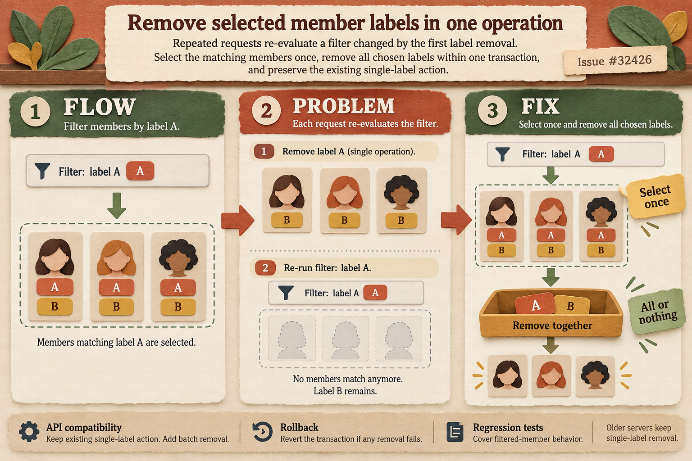
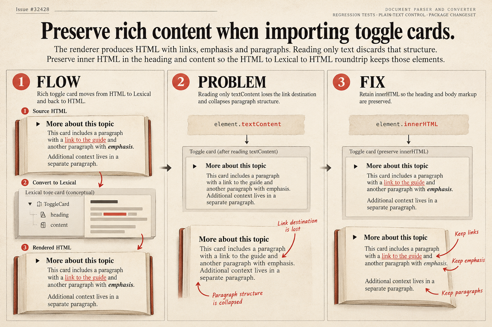

# Ghost functional bug fixes: visual documentation

Three selected P2 fixes, each with a separate visual theme. No P0 or P1 was confirmed in the ten additional review rounds. Security and daybreaks were outside the audit scope.

## Settings — engineering blueprint

The form sends version A while the user edits version B. The older response must leave B editable and unsaved. [Issue #32421](https://github.com/TryGhost/Ghost/issues/32421) · [Explanation and evidence](settings/infographic_report.md).

## Member labels — paper-cut workshop

Select matching members once, then remove the selected labels in one transaction. Older servers keep single-label removal. [Issue #32426](https://github.com/TryGhost/Ghost/issues/32426) · [Explanation and evidence](labels/infographic_report.md).

## Toggle cards — editorial print

Preserve heading and body HTML so conversion keeps links, emphasis and paragraphs. [Issue #32428](https://github.com/TryGhost/Ghost/issues/32428) · [Explanation and evidence](toggle/infographic_report.md).

## Generation and review

All three images were generated with the native image generation tool and visually checked. Each folder contains `infographic.png`, `infographic_report.md`, prompt inputs and generation instructions. The helper was run directly using Python, without uv. The illustrations explain behavior; they do not substitute for test evidence.

The themes deliberately differ in palette, typography and visual metaphor. They contain no invented test counts or performance claims. Public pull request descriptions link these artifacts from a documentation branch in the contributor's fork.

Other confirmed bugs remain documented as issues without consuming a PR slot: [pagination #32427](https://github.com/TryGhost/Ghost/issues/32427), [product-card conversion #32429](https://github.com/TryGhost/Ghost/issues/32429), and the earlier [subscriber history #32420](https://github.com/TryGhost/Ghost/issues/32420).
