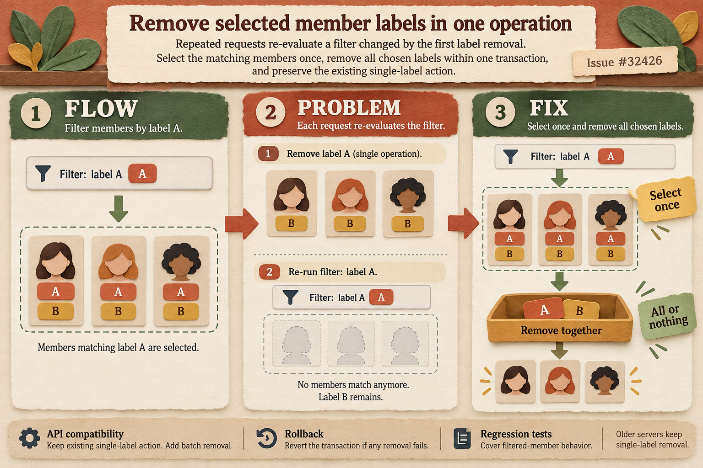

# Members: remove labels from one stable selection

Issue: https://github.com/TryGhost/Ghost/issues/32426

## Architecture, problem and solution

The Admin sends a member filter and the chosen labels to Core. Previously, each label used a separate request. Removing label A could make members stop matching the filter before the request to remove B, leaving B attached despite a success message.

The new bulk action selects members once and removes the chosen label relations in one transaction. A failed deletion rolls the transaction back. The existing single-label action remains available. Core announces support in its configuration, so Admin allows multiple labels only when the server supports the action. Older servers keep single-label removal.

## Illustration

Theme: tactile paper-cut workshop, using ivory, terracotta, moss and mustard. Member cards and detachable labels explain the fixed selection and transaction. This is a conceptual illustration, not a screenshot or a validation result.

Generated using the native image generation tool. See [prompt inputs](prompt.json), [exact generation prompt](generation-prompt.txt), and [validation results](results.md).
