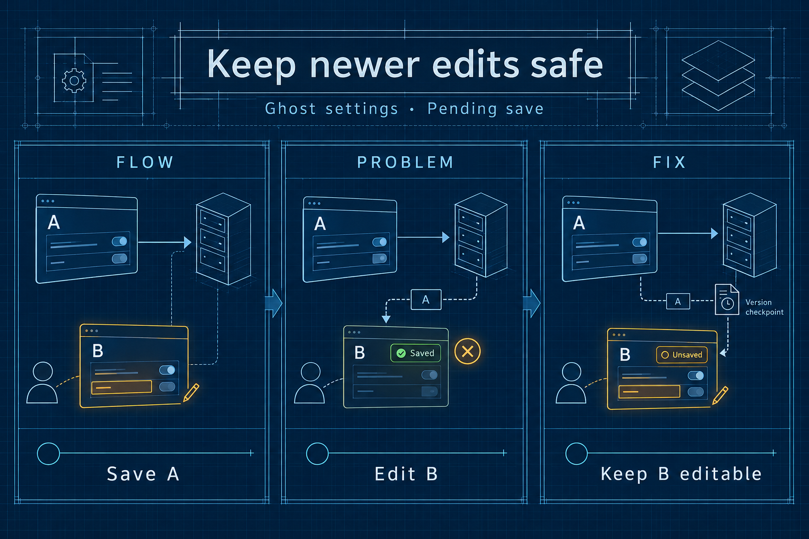

# Settings: preserve edits made during a save

Issue: https://github.com/TryGhost/Ghost/issues/32421

## Architecture, problem and solution

The settings panel keeps a local form while a request sends its current values to the server. If the user sends version A and then types version B, the response for A must not replace B or close the panel as though B were saved.

The form records which version each request belongs to and prevents overlapping saves. A newer edit stays marked as unsaved, preserving discard warnings. Settings responses refresh the local form only after editing ends. A later explicit save persists B.

## Illustration

Theme: engineering blueprint, with navy, cyan and amber. This conceptual illustration explains the data flow; it is not a screenshot or proof of validation.

Generated using the native image generation tool. See [prompt inputs](prompt.json) and [generation notes](generation-prompt.txt). Validation is recorded separately in [results](results.md).
