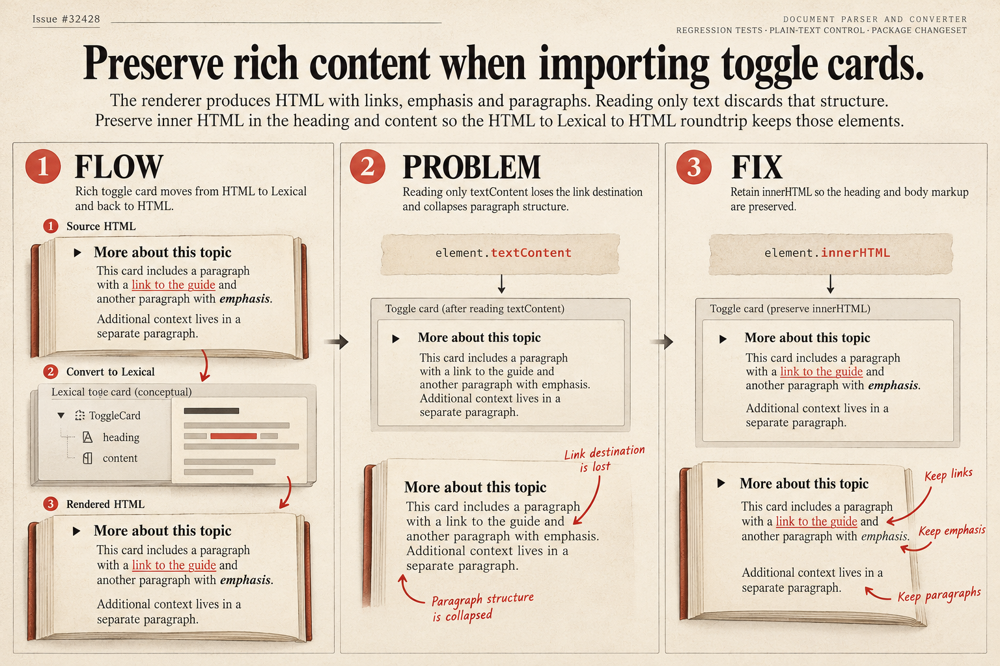

# Toggle cards: preserve rich content during HTML conversion

Issue: https://github.com/TryGhost/Ghost/issues/32428

## Architecture, problem and solution

Ghost converts imported HTML into Lexical cards, which can later be rendered back to HTML. Toggle headings and bodies store HTML. Reading only their text removes link destinations, emphasis and paragraph boundaries during conversion.

The parser now reads the inner HTML of both fields, preserving the markup expected by the editor and renderer. Regression tests exercise the node parser and the public HTML-to-Lexical converter, including plain content and escaped characters. The package has a patch changeset.

## Illustration

Theme: editorial print, using ivory newsprint, charcoal and vermilion. Book pages show the conversion and the preserved structure. This is a conceptual illustration, not a screenshot or a validation result.

Generated using the native image generation tool. See [prompt inputs](prompt.json), [exact generation prompt](generation-prompt.txt), and [validation evidence](evidence.md).
