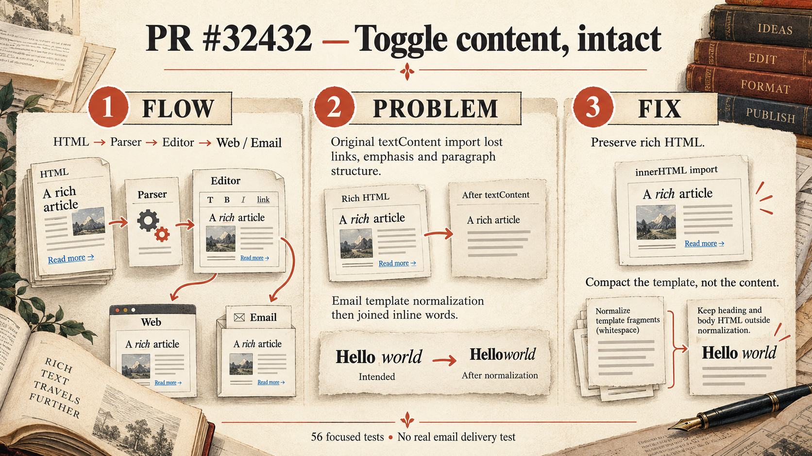

# PR 32432: how toggle formatting reaches the page and email

Generated with the native image tool for this PR. See the [generation prompt and visual review](image-generation.md) and [theme directives](infographic_prompt.json).

A toggle card starts as HTML. The parser takes its heading and body into a Lexical document, which can later be rendered as a web page or an email. Previously the parser kept only the text, losing supported formatting such as links, emphasis and paragraph breaks. Preserving the fields' inner HTML keeps that formatting for the supported cases checked here.

The earlier implementation exposed a separate email issue: when formatted words were adjacent, template whitespace compaction could remove the space between them. The final email renderer keeps the heading and body outside that compaction step, preserving spaces such as the one in **Hello** _world_. The focused import-to-email regression checks both the text and inline markup.

The illustration is a conceptual explanation, not a complete security or compatibility claim. Preserving formatting does not establish HTML sanitization, and arbitrary HTML is not guaranteed to survive an editor round trip. The focused tests do not establish browser behavior, actual email delivery or a full repository check. See [evidence.md](evidence.md) for the exact test results, the observed trust boundary and the byte-level email HTML difference.
