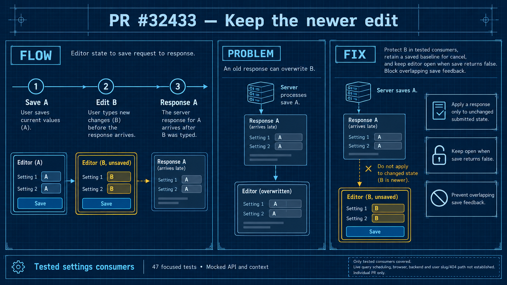

# PR 32433: settings edits during a pending save

Generated with the native image tool for this PR. See the [generation prompt and visual review](image-generation.md) and [theme directives](infographic_prompt.json).

When the user saves A, the browser records the form version associated with that request. If the user changes the form to B before A finishes, the older completion must not mark B as saved or overwrite it. The version is local browser state; it is not a server-issued version token.

The follow-up protects the tested settings and Design states during refreshes and guards selected response setters. Navigation and Stripe Direct honor an unsuccessful save result before closing. The settings group retains the latest saved response as the baseline for cancel and unchanged saves, so handling an older response does not mean discarding every part of it.

The diagram describes the intended behavior. The focused tests passed for selected hooks and rendered consumers with mocked dependencies. They do not establish every caller, browser keyboard behavior, live React Query ordering, a backend write, or User Detail slug changes and settled 404 responses. See [the evidence and reproduction instructions](evidence.md) for the exact revision and results.
