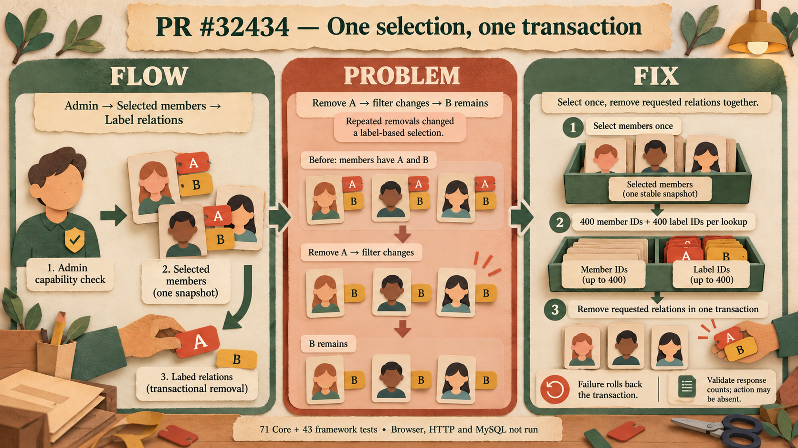

# PR #32434: one selection, one label-removal transaction

Generated with the native image tool for this PR. See the [generation prompt and visual review](image-generation.md) and [theme directives](infographic_prompt.json).

Admin lets a user filter members, for example to people with label A. Previously, removing A and B meant sending two separate requests using that same filter. Once A was removed, those members no longer matched the filter, so the later request could leave B attached.

The new action asks Core to select the matching member IDs once, at request time. Core looks up their selected label relations and removes them in one transaction. If a later deletion fails, the transaction can roll back the earlier deletions. Admin enables the multi-label path only when Core advertises support, retaining the single-label flow for older servers.

The follow-up keeps each relation lookup bounded: it deduplicates labels and pairs up to 400 member IDs with up to 400 label IDs, for at most 800 ID parameters in a lookup. The client also validates the two nonnegative integer statistics while accepting responses with or without `action`. A successful count describes selected relations, not the number of distinct members; concurrent changes can make it differ from affected rows.

The illustration explains the design. The isolated SQLite probe checked a real rollback of 102 relations, but its filter was a SQL stand-in. Browser, HTTP and MySQL validation, a full branch check and production performance measurements remain open. CI and Tinybird were `action_required` in the recorded snapshot. See the [test evidence and exact limits](evidence.md) and the [final source commit](https://github.com/JoaoMarcos44/Ghost/commit/1cdac3b534035e02d995160c0b37d330e47b5ea5).
